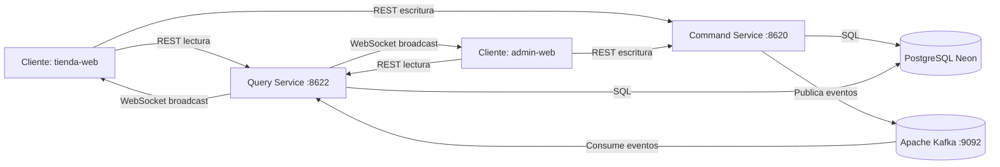
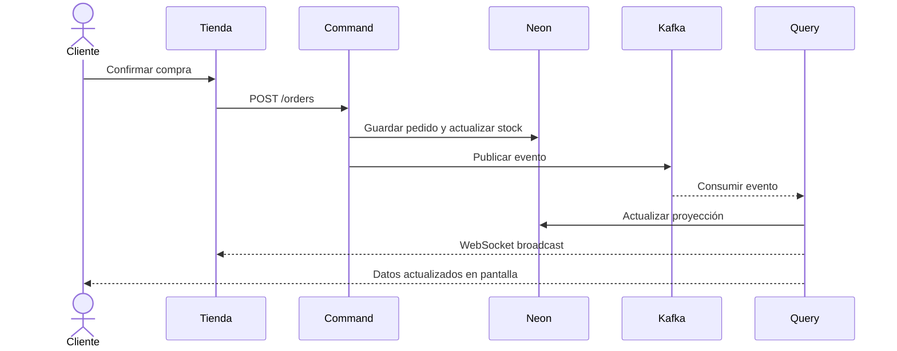

# Arquitectura distribuida

## Componentes

## CQRS
- **Command Service:** operaciones que cambian el estado: crear/editar productos y registrar pedidos.
- **Query Service:** consultas del catálogo y los pedidos; consume eventos Kafka para mantener proyecciones.
- **Persistencia:** `products_command`, `orders_command`, `products_query`, `orders_query`. Las cuatro tablas están en **una misma base PostgreSQL Neon**, pero con responsabilidades separadas.

## Secuencia de compra

## Tecnologías y decisiones
Consulta [Tecnologías y justificación](Tecnologias-y-justificacion.md) y [Requerimientos](Requerimientos.md).
